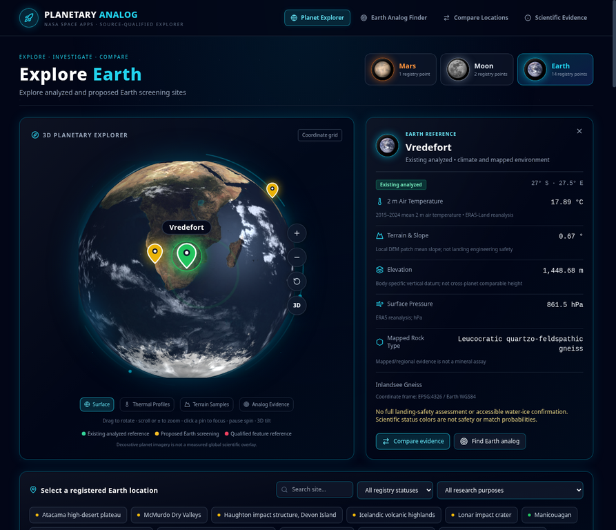
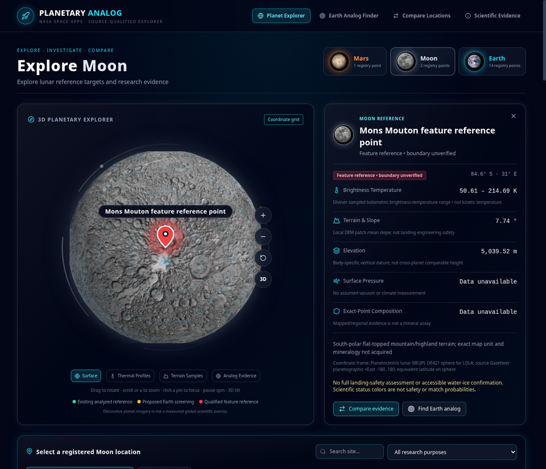

# TerraTwin correction report

## Result and reference-image limitation

The existing React/Three.js/FastAPI integration was corrected in place. The original dark-space page structure, cyan glass-panel styling, glowing teardrop markers, planet controls, decorative assets and interaction speeds were retained. No replacement website, design system, new reference imagery or scientific acquisition was introduced. The downloadable correction includes the real backend datasets and the rebuilt frontend.

**Exact comparison with the user's TerraTwin design screenshots is not completed:** no such images were present in the accessible uploads or the original frontend ZIP (which contains `frontend.txt`). The images were requested. `screenshots/Earth_corrected.webp` and `screenshots/Moon_corrected.webp` are captures of the actual corrected app, not user reference images. They cannot prove a match to an unavailable reference. The originally supplied frontend remains byte-identical in `original_frontend/frontend.txt`.

## Corrected defects

| Area | Confirmed issue and correction |
|---|---|
| Planet appearance | A body change previously retained the preceding planet's material until an asynchronous image request completed. Surface/cloud/material/atmosphere reset now happens before paint and later requests are cancellation-scoped. Earth never retains orange Mars pixels during loading. A deliberately delayed Earth source image was tested successfully. |
| Earth rendering | Existing Earth oceans, green/brown land and white clouds are retained, with the original cyan-blue atmospheric rim. Color textures now use correct sRGB interpretation. The existing RGB Earth normal-map asset is used as a normal map, not grayscale bump height. No scientific surface map was invented. |
| Globe pins | A direction-only visibility threshold wrongly exposed rear-rim points under a perspective camera. Visibility now follows the camera-to-surface horizon. The actual SVG pin tip anchors to the projected body coordinate even when scaled; positions rotate with the surface texture. |
| Focus | Focusing uses the nearest equivalent longitude rotation and compensates tilt; high-latitude lunar references can centre instead of being stopped by the old latitude clamp. Original interpolation, drag, spin and zoom speeds remain. |
| Category colors | Green means the three analyzed Earth references; yellow means the eleven proposed Earth screening points; red means the three qualified Moon/Mars feature references. These are registry/evidence categories, never danger, landing-safety or matching probabilities. Cards now use their own site's category rather than the other comparison candidate's status. |
| Region/site filters | Search/status/purpose filtering now selects a visible result instead of silently retaining an excluded site's panel/chart. No-result filters show the existing panel's empty state and no stale chart or pins. Opening a different world's site clears unrelated filters. |
| Async scientific data | Request-path identity prevents previous chart/comparison/recommendation data appearing under a newly selected target while the new request starts. Existing cancellation and error/retry handling remain. |
| Comparisons/recommendations | Each selected pair drives the source-qualified API records. Category choices are deduplicated; selected target state updates directly. Actual recommendation cards update for all three planetary targets. No unsupported overall best-match percentage was added. Long comparison controls wrap at narrow widths without changing desktop page structure. |

## Executed verification

**53 frontend tests passed**, including the prior 30 scientific/preservation tests and 23 added coordinate/focus/horizon/color/selection tests. **69 backend tests passed.** TypeScript checking and the production frontend build passed. The non-blocking Vite large-chunk warning remains; sustained frame-rate and physical-device certification are not claimed.

Live browser tests selected all **17 real sites** and confirmed each panel's five numeric/text fields, site ID, chart ID and visible pins matched the backend's correct body/site. All three planetary targets returned the expected **14 Earth evidence cards** for impact-crater morphology. Three different comparison pairs updated correctly and exposed 11 unique category options including “all.” Direct Earth marker selection changed both panel and chart to the clicked site. Search selection and empty-state tests passed. The lunar polar reference settled near the globe centre at the preserved animation speed.

Mouse-drag and synthetic touch-handler events moved an existing visible pin; zoom/spin/tilt/grid controls remain wired, and only one globe canvas was present. A 390-pixel iframe test loaded Earth with a 320-pixel globe and verified explorer, comparison controls and recommendation cards fit without horizontal overflow. This is a CSS/browser-handler check, not physical touch-hardware or cross-browser certification.

Two initial tool-driven checks used too-short fixed sleeps (pin focus and iframe data loading). Those checks failed at the test-readiness assumption; the rechecks waited for the selected visible pin/actual registry controls and passed. The timing caveat is preserved rather than described as an initial pass.

## Scientific preservation and delivery

The scientific runtime files, site coordinates, saved chart series, product labels, missing values, quality flags, six crater-profile scores and source-qualified recommendation/comparison records are unchanged. Coverage remains **14 Earth / 2 Moon / 1 Mars, 104 chart files, 420 comparison rows and 210 recommendation rows**. The offline package builder checks byte identity against the original MASTER archive and verifies ZIP member checksums.

Lunar temperatures remain brightness retrievals, Mars MCD values remain model states, Earth air temperature remains distinct from MODIS LST, proposed sites remain proposed, and unavailable measurements remain unavailable. No safety certification, accessible-ice confirmation or global scientific heatmap has been fabricated.

Run instructions, API documentation, scientific mappings and the original frontend audit remain included. Open the existing Preview to inspect the correction. A public deployment and Docker image build were not performed. Exact user-screenshot alignment remains pending receipt of those images.

## Evidence locations

`validation/correction/browser/` contains the actual executed browser outputs; `validation/correction/frontend_tests.txt`, `backend_tests.txt` and `build.txt` retain the correction test logs. `validation/correction_selection_review.*` is the independent pre-fix read-only review. `validation/correction/reference_status.json` records the missing-reference limitation. Current final logs are also provided in the original `validation/frontend_*` paths.

