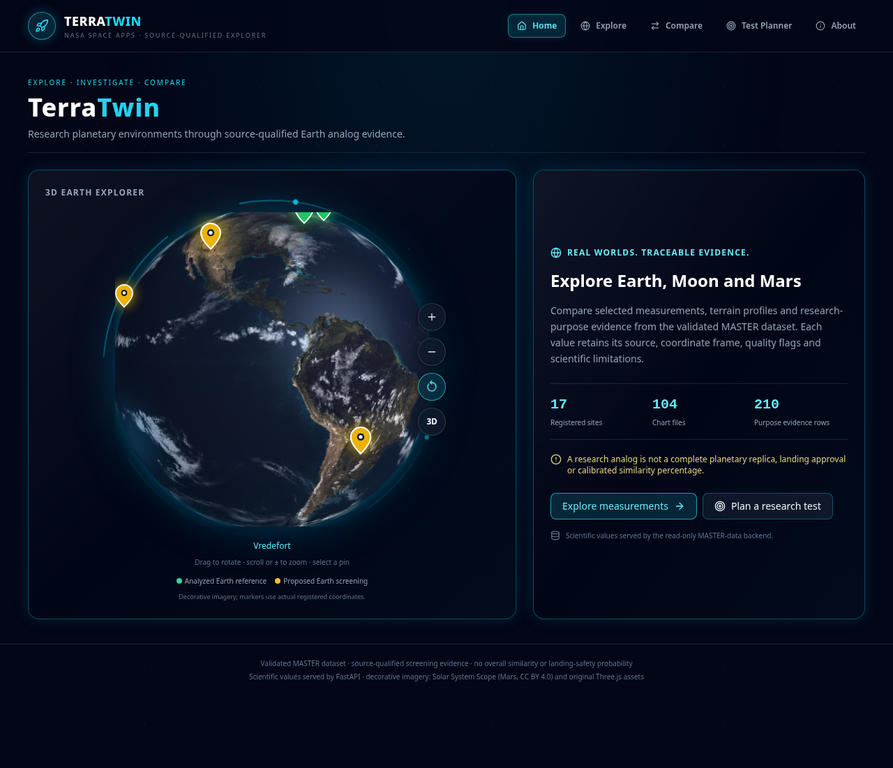
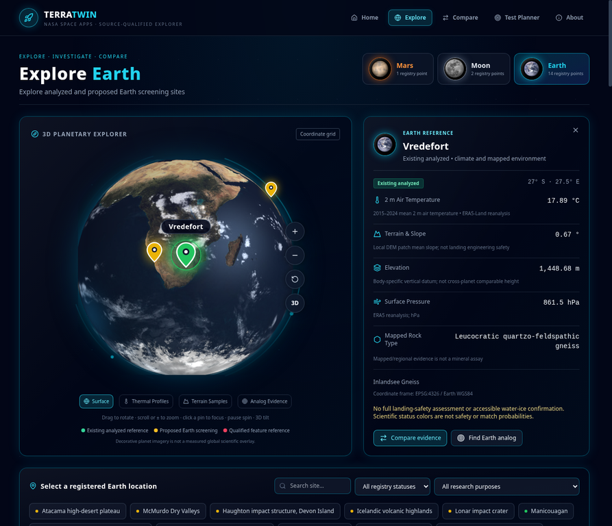
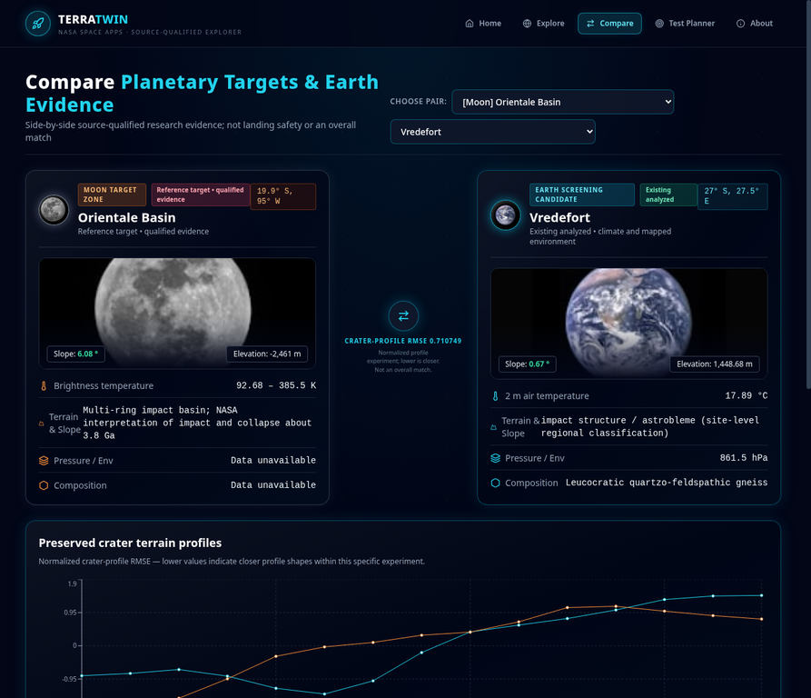
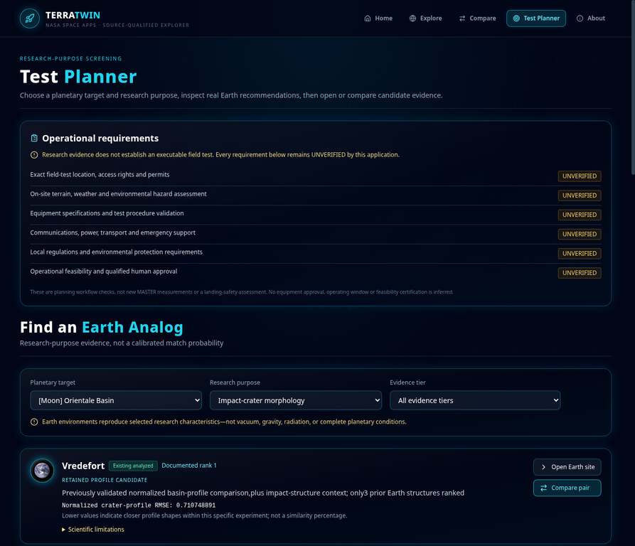
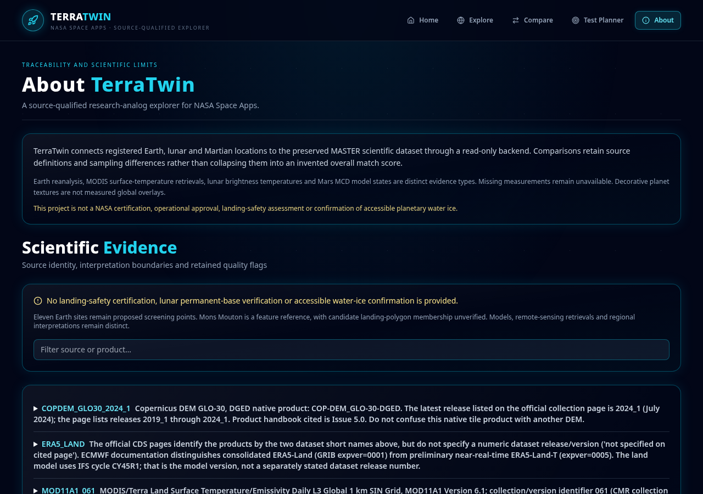

# TerraTwin final quality check

The working five-page app passes the executed automated and production-browser checks. It is ready in the existing Preview, which now serves the compiled React frontend and the real FastAPI backend together—not the Vite development server. **Two requested checks remain unresolved:** exact comparison with the user's unavailable reference screenshots, and verification of a separately published deployment pending private-publication authorization. This report does not label those checks as passed.

## Five-page completion and original design

Home (`/`), Explore (`/explore`), Compare (`/compare`), Test Planner (`/test-planner`) and About (`/about`) work through navigation, direct URLs and browser Back/Forward. The final check found only four previous views, so the missing required page wrappers were completed using the existing glass panels, globe, colors, typography classes and transitions. Explore and Compare reuse their existing implementations; Test Planner wraps the real Analog Finder with operational-gap notices; About reuses the scientific evidence views. The navigation labels and TerraTwin name were aligned with the requested pages. No replacement design system, new illustration or scientific acquisition was introduced.

The original source file remains byte-identical. Its original application shell was incomplete, and the accessible uploads contain no TerraTwin design screenshots. The retained shared component/style tests pass, but **exact screenshot parity cannot be certified** without those images.

## Executed checks

| Requested check | Result and evidence |
|---|---|
| Five pages and navigation | PASS: all five direct production routes serve built HTML; browser navigation and Back/Forward passed. |
| Original design screenshots | UNVERIFIED: source/style preservation checked, user reference images unavailable. |
| Realistic Earth | PASS: actual Home/Explore screenshots show blue oceans, green/brown land, white clouds and the retained cyan-blue atmosphere. The earlier stale Mars-texture defect remains corrected. |
| Markers and legend | PASS: all 17 registered body coordinates and focus projections pass automated tests. Original green/analyzed-Earth, yellow/proposed-Earth and red/qualified-planetary reference categories are explained by the legend—not similarity or safety percentages. Perspective occlusion hides far-side pins rather than plotting them incorrectly. |
| Globe controls and motion | PASS for executed mouse/touch-handler drag, zoom, spin, tilt, coordinate grid and world switching. Original motion constants remain. One canvas was present. This is not sustained FPS or physical-device certification. |
| MASTER-to-backend scientific linkage | PASS: 14 Earth, 2 Moon, 1 Mars; 104 chart files; 420 comparison records; 210 purpose-evidence records. The package byte-preservation check covers all 124 runtime scientific input files. |
| Site/region/comparison updates | PASS: all 17 production site selections matched panel ID, chart ID, selected texture body and body-scoped pins. Actual Orientale–Vredefort pair evidence was selected and captured. |
| Test Planner | PASS: all three planetary targets returned 14 real Earth evidence cards for the checked impact-morphology purpose. Six operational checks remain visibly UNVERIFIED: exact location/access, hazards, equipment/procedure, logistics/emergency support, regulations/environment and qualified feasibility approval. |
| No invented science or broken internal links | PASS for automated integrity/score/security tests and internal production routes/assets. Unavailable values remain unavailable; crater RMSE is a scoped experiment, not an overall percentage. Official-source HEAD checks found 31 reachable URLs and 1 access-restricted NASA catalog URL among 32 checked; restricted access is not represented as a verified downloadable product. |
| Desktop/mobile and console | PASS for the executed desktop and 390px-browser-frame five-page checks: no horizontal overflow or captured application errors. Earth globes were320pxwide in the mobile frame. Physical devices, every browser and sustained performance were not certified. |
| Deployed environment | PARTIAL: actual production entry point and externally forwarded Preview passed five-page HTML and same-origin API checks. Private publication was requested for approval but has not been authorized/completed; no separate hosted-deployment pass is claimed. |
| Tests/build after final code changes | PASS: 63 frontend tests, 79 backend tests, TypeScript checking and production build. Non-blocking warnings: large Vite JS chunk and Starlette/anyio deprecation. |

## Production and browser evidence

`validation/final/production_http.json` records built HTML for the five pages, API health/readiness/summary and404 guards for unknown routes and missing assets. `validation/final/forwarded_preview_check.json` records HTTP200 and expected HTML/JSON for the externally forwarded Preview origin. This is a working production Preview, **not a published private or public deployment**.

`validation/final/browser/` contains the all-site/target, five-page navigation/history, mobile-layout and globe-control results. Some initial capture/test attempts used the wrong readiness or browser-context assumptions: premature parallel captures included loading placeholders, a mobile test ran after the capture tool left the shared browser on `about:blank`, and a spin assertion read the DOM before React committed state. Only completed-page captures are delivered. The affected checks were rerun with actual readiness/correct origin/state commit and passed; the initial failures are not misreported as passes.

The original thumbnail fallback photos were bundled unchanged from their existing URLs, eliminating remote image errors without replacing their appearance. Missing API/asset requests stay404 and do not receive misleading successful SPA HTML. No credentials, arbitrary local paths, fake measurements or fictional demo-site fallback are exposed by the tested API.

## Delivery and remaining approval

The complete final project includes source, production build, immutable scientific input copies, tests, final screenshots, API/scientific-mapping documentation, Dockerfile and one-command setup/start scripts. `RUN_AND_DEPLOY.md` provides explicit local and deployment instructions. The previous correction archive remains available separately; the final archive adds the requested five-page completion and this QA evidence.

**Release status: verified working production Preview and packaged project; exact-reference comparison and separately published-deployment verification pending.** No further visual changes are proposed. If private publication is approved, publish this saved version and verify its resulting hosted HTML/assets/API before recording a deployed pass. Do not make it public without separate permission.

## Completed-page screenshots

These are actual captures of the final app, not mockups or user reference images. Compare shows an explicitly selected Orientale–Vredefort pair; Test Planner shows real Orientale research recommendations. Screenshots are viewport captures; longer source/evidence sections are available by scrolling.

